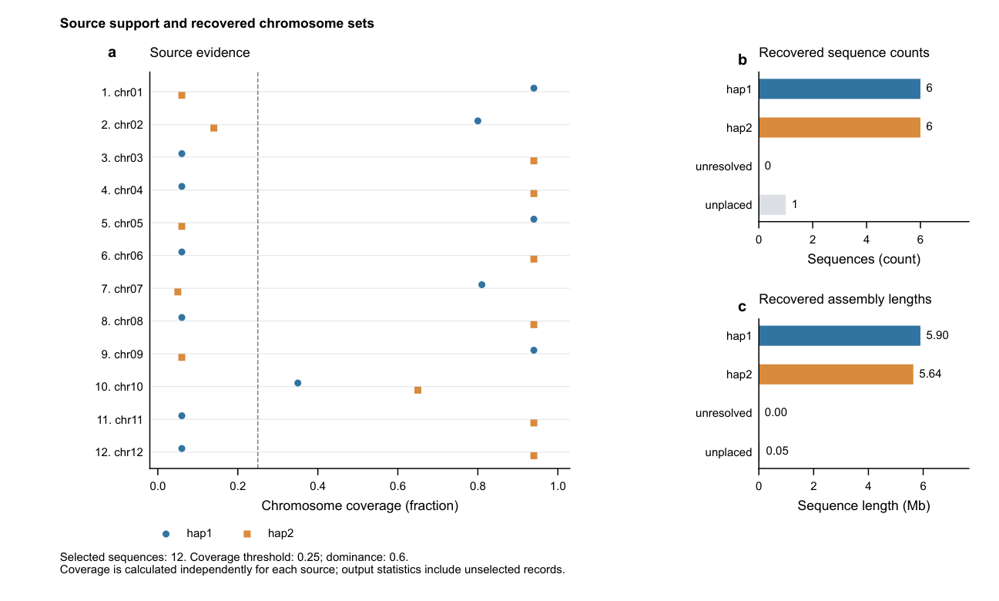
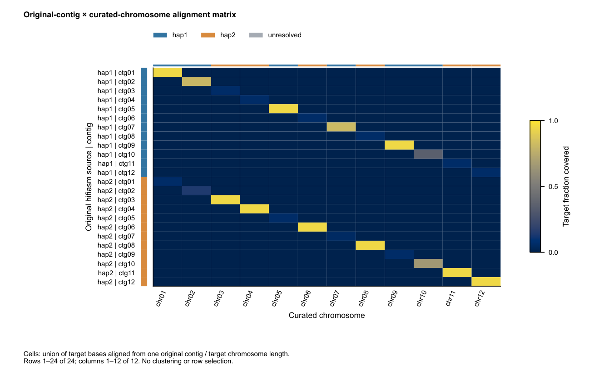
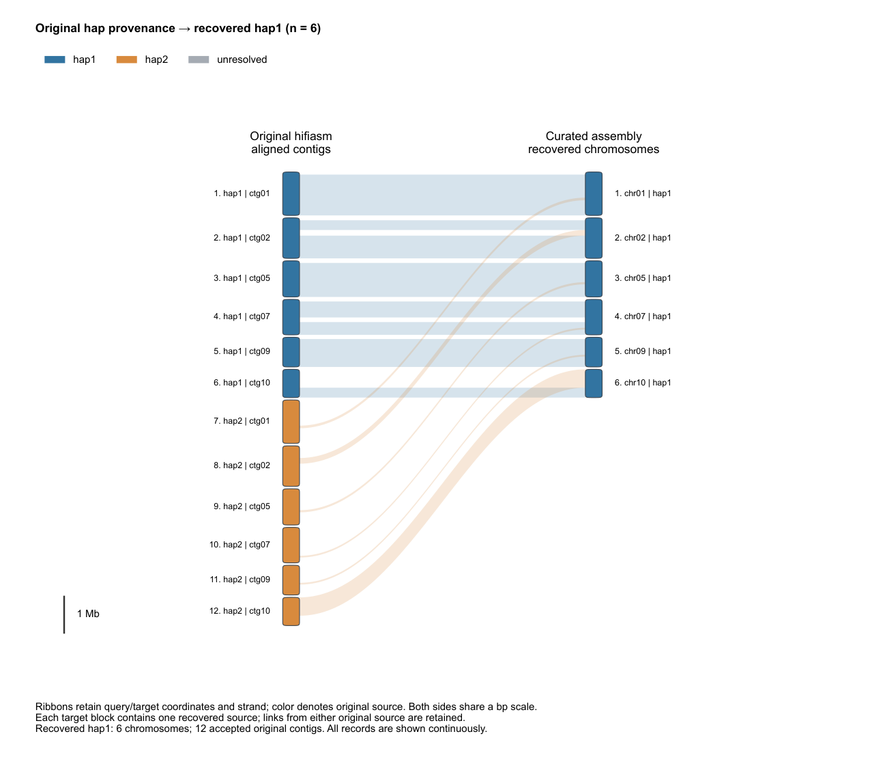

# HapReturn

**Recover two chromosome sets from a curated merged assembly using original hifiasm provenance and equal-copy homolog-group constraints.**

HapReturn traces the original hap1/hap2 contigs back to the curated assembly,
then recovers two chromosome sets with equal copy counts within each homolog
group. The logic is the same for diploid, tetraploid, octoploid and higher
even-ploidy assemblies: **2n → n + n**.

```text
original hap1 + original hap2 → merge → HapHiC / Juicebox → curated 2n
      |                |                                     |
      +----------------+------------ HapReturn --------------+
                                        |
                         alignments + source provenance
                                        |
                         homolog groups of P chromosomes
                                        |
                     maximize support with P/2 per source
                               /                \
                          hap1 (n)           hap2 (n)
                               \                /
                        PDF figures + HTML report
```

[中文说明](README.zh-CN.md) · [Method](docs/method.md) · [Figure gallery](#figure-gallery)

## At a glance

- **Recover two sets:** assign chromosomes using original hifiasm source evidence.
- **Balance within homolog groups:** select the combination with the highest total support, with half the chromosomes assigned to each source.
- **Resolve local provenance:** expand evidence windows within contiguous unresolved regions and retain the recorded evidence.
- **Inspect the result:** export chromosome counts, lengths, assignment tables, three PDF files and a self-contained HTML report.

## Install

Python 3.9+ is required. Install minimap2 for FASTA alignment; existing PAFs can be reused. Matplotlib is installed automatically.

```bash
python -m pip install .
hapreturn --version
```

## Input order

Place chromosome scaffolds first during Juicebox curation and arrange homolog groups consecutively. A tetraploid input has records 1–4 in the first group, 5–8 in the second, and so on. An octoploid input has eight records per group. The equal-copy assumption must match the input design; no fixed subgenome labels are required.

`--chromosome-count N` selects the first N FASTA records without length sorting. Remaining records go to `unplaced.fa`. Alternatively, supply `--homolog-groups groups.tsv` with columns `group_id` and `seq_id`, listing all selected chromosomes exactly once.

## Run

```bash
hapreturn \
  --final-fasta curated.fa \
  --hap1-fasta original.hap1.fa --hap2-fasta original.hap2.fa \
  --chromosome-count 56 --ploidy 4 --threads 24 \
  --out-dir result
```

The default balanced mode assigns two of every four homologs to each source, producing 28 + 28 records. At ploidy eight it assigns 4 + 4 per group. An even `--ploidy` is required.

Use `--hap1-paf` and `--hap2-paf` instead of source FASTAs to reuse alignments. Queries must be original contigs; targets must be the curated assembly. Exactly two custom labels can be supplied with `--source-paf LABEL=PATH` or `--source-fasta LABEL=PATH`.

## Assignment

After filtering at mapQ ≥10 and alignment length ≥10 kb, merge overlapping target intervals within each source. For each chromosome, C1 and C2 are union-covered target bases. Assign the P/2 largest differences C1−C2 to source 1 and the remainder to source 2. This exactly maximizes total support under the group balance constraint.

`assignment.tsv` retains final labels, independent evidence labels, group IDs, and final-source coverage. Independent evidence uses coverage ≥0.25 and dominance ≥0.60 by default. `group_qc.tsv` records total support, the optimality gap, changed evidence, and tied optima. Ties use stable input order and are flagged for review; zero evidence is recorded as such.

Use `--assignment-mode provenance` for independent source tracing with potentially unequal output counts. In that mode, groups and copy quotas provide optional QC only.

## Local unresolved windows

Within each original contiguous gray run, expand an unresolved window's evidence context geometrically up to the full run length. Reuse existing PAF evidence, preserve raw coverage, and do not borrow evidence from resolved neighboring runs. Retain gray when the expanded context does not meet coverage and dominance thresholds.

`window_provenance.tsv` records raw and revised labels, method and evidence span. `window_rescue.tsv` records every context attempt. Local labels are separate from chromosome group assignments.

## Outputs

- `hap1.fa`, `hap2.fa`, `unresolved.fa`, `unplaced.fa`: sequence partitions.
- `assignment.tsv`, `summary.tsv`, `homolog_groups.tsv`, `group_qc.tsv`: assignment evidence and checks.
- `partition.pdf`: source evidence, counts, lengths and chromosome provenance.
- `alignment_matrix.pdf`: original-contig × curated-chromosome support.
- `hap_comparison.pdf`: one continuous, height-adaptive correspondence figure per recovered source.
- `report.html`: all figures, source statistics, window hover and numbered filtering.

The correspondence figures retain accepted links from both original sources. PDFs use editable text; figures are exported as separate PDFs and one portable HTML.

## Figure gallery

All previews below use **synthetic sequences and alignment coordinates**. The
example contains three tetraploid homolog groups, recovered as six chromosomes
per source. Blue and orange always denote the original hifiasm sources; gray
denotes unresolved local evidence. Whole-chromosome assignments and local
source colors are shown separately.

### Source support and recovered sets

Independent coverage for each chromosome, together with the recovered sequence
counts and assembly lengths. Horizontal guides make chromosome comparisons
easier to follow. This is the first figure in `partition.pdf`.



### Chromosome-scale source provenance

Length-scaled chromosome outlines show local source evidence, with recovered
hap1 and hap2 on separate rows. In this example, chr10 is assigned to hap1 by
the group constraint despite stronger independent hap2 support; its local
colors retain that evidence. This is the second figure in `partition.pdf`.


### Original-contig alignment matrix

Rows represent original contigs and columns represent curated chromosomes.
Each cell gives the fraction of the target chromosome covered by one contig;
colored keys identify the original source and the recovered assignment.
Exported in `alignment_matrix.pdf`.



### Original-to-recovered correspondence

Coordinate-aware ribbons connect original contigs to recovered chromosomes.
Each recovered source has one continuous figure in `hap_comparison.pdf`;
the hap1 example is shown below. Ribbon colors identify the original source,
including accepted links from hap2 to chromosomes recovered in hap1.



### Reproduce the gallery

After installation, run these commands from the repository directory. Existing
synthetic PAFs are generated directly, so minimap2 is not needed for this demo.

```bash
python examples/visualization/generate.py demo_input
hapreturn \
  --final-fasta demo_input/final.fa \
  --hap1-paf demo_input/hap1.paf --hap2-paf demo_input/hap2.paf \
  --chromosome-count 12 --ploidy 4 --plot-window-size 12000 \
  --allow-unresolved --out-dir demo_report
```

Open `demo_report/report.html` to explore all figures and the numbered assignment
table. The example intentionally includes one group requiring review, recorded
in `group_qc.tsv`; the final chromosome counts are 6 + 6.

## Refresh an existing report

```bash
hapreturn-report --result-dir result --out-dir refreshed_report
```

This preserves chromosome assignments and redraws figures with local window expansion. To apply balanced assignment to an earlier result, rerun the main command with the original curated FASTA, existing PAFs and ploidy, using a new output directory. Reuse any customized filtering and window settings.

## Standalone correspondence figure

```bash
hapreturn-chromosomes \
  --final-fasta curated.fa --hap1-paf hap1.paf --hap2-paf hap2.paf \
  --assignment result/assignment.tsv --out-pdf original_to_curated.pdf
```

## Synthetic octoploid example

```bash
hapreturn --final-fasta examples/octoploid/final.fa \
  --hap1-paf examples/octoploid/hap1.paf --hap2-paf examples/octoploid/hap2.paf \
  --ploidy 8 --min-aln-len 1 --out-dir example_result
```

Exit status: 0 passed; 1 input/runtime error; 2 outputs available with review flags. `--allow-unresolved` accepts review-required output. MIT license.
