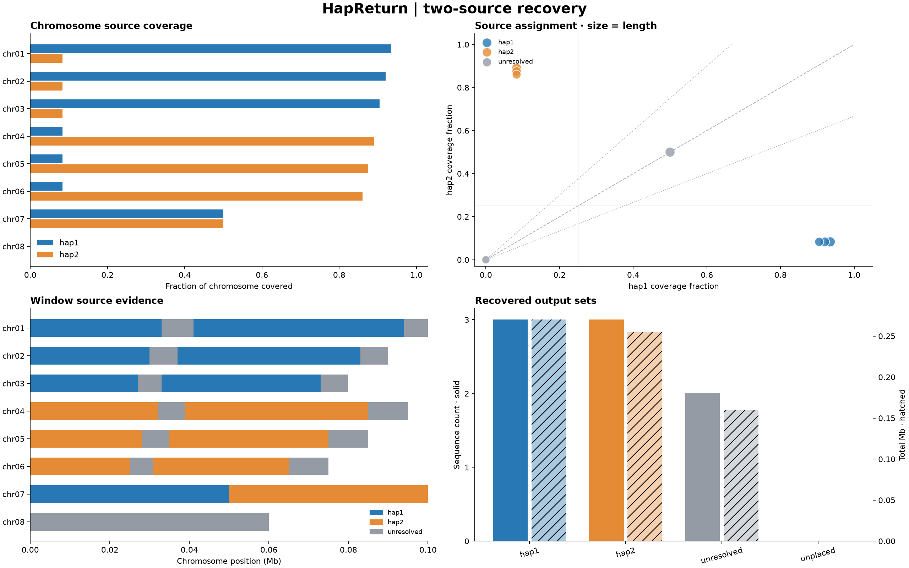

# HapReturn

**Return a merged 2n assembly to two n sets using original hifiasm hap1/hap2 provenance.**

HapReturn aligns the two original hifiasm contig sets to a curated merged
assembly and recovers the chromosome sets belonging to hap1 and hap2.
The workflow is identical at any ploidy: **2n → n + n**.

```text
original hap1 + original hap2 -> merge -> scaffold and curate -> final 2n
      |                |                                         |
      +----------------+----------- HapReturn -------------------+
                                      |
                              hap1 (n) + hap2 (n)
```

[中文说明](README.zh-CN.md) · [Method](docs/method.md)

## Install

Requires Python 3.9+. Install minimap2 to align FASTA inputs; existing PAFs can
be processed directly without additional Python dependencies.

```bash
python -m pip install .
hapreturn --version
```

## Run

Use the same command for diploid, tetraploid, octoploid and higher-ploidy inputs:

```bash
hapreturn \
  --final-fasta curated.fa \
  --hap1-fasta original.hap1.fa --hap2-fasta original.hap2.fa \
  --chromosome-list chromosomes.txt --threads 24 \
  --out-dir result
```

`chromosomes.txt` lists the 2n chromosome identifiers, one per line. Alternatively,
`--chromosome-count N` selects the first N FASTA records; omit both options to
classify all records. Unselected records go to `unplaced.fa`.
The number n is half of the selected chromosome count: for 64 chromosomes,
the expected split is 32 + 32. No ploidy setting is required for assignment.

Use `--hap1-paf` and `--hap2-paf` to supply existing alignments instead of
source FASTAs. PAF queries are original contigs and targets are the final assembly:

```bash
minimap2 -x asm5 --secondary=no -t 24 curated.fa original.hap1.fa > hap1.paf
```

Run the bundled two-source example:

```bash
hapreturn \
  --final-fasta examples/octoploid/final.fa \
  --hap1-paf examples/octoploid/hap1.paf \
  --hap2-paf examples/octoploid/hap2.paf \
  --min-aln-len 1 --out-dir example_result
```

Expected: 16 input chromosomes split into 8 hap1 and 8 hap2 chromosomes.
The 1 bp cutoff is for this small synthetic example.

## Visualization

Each run automatically exports a four-panel overview and individual source
coverage, assignment scatter, chromosome-window and output-summary figures in
PNG, SVG and PDF. Open `report.html` for a self-contained report with window
hover details and a searchable, source-filtered assignment table.



Coverage bars show each source independently because their aligned regions may
overlap. Point area scales with chromosome length. Window labels use the same
coverage and dominance thresholds as chromosome assignments, applied locally;
gray windows have unresolved evidence. Counts and total lengths are displayed
separately. All ploidies use the same two-source visualization.

`--plot-window-size N` sets the window width in bases (default: approximately
100 windows on the longest chromosome). `--no-plots` skips report generation.
To reproduce the illustrated synthetic report:

```bash
python examples/visualization/generate.py demo_input
hapreturn --final-fasta demo_input/final.fa --hap1-paf demo_input/hap1.paf \
  --hap2-paf demo_input/hap2.paf --min-aln-len 1 --allow-unresolved --out-dir demo_report
```

`window_provenance.tsv` contains union-covered bases per source for each
zero-based, half-open window. Reports are also generated when assignment QC
returns exit code 2.

## Parameters

| Option | Default | Purpose |
|---|---:|---|
| `--min-mapq` | 10 | Minimum PAF mapping quality |
| `--min-aln-len` | 10000 | Minimum alignment block length in bases |
| `--dominance` | 0.60 | Minimum dominant-source share of covered bases |
| `--min-covered-fraction` | 0.25 | Minimum dominant-source chromosome coverage |
| `--preset` | asm5 | minimap2 preset |
| `--threads` | 8 | minimap2 threads |
| `--allow-unresolved` | off | Accept partial results |
| `--force` | off | Reuse a nonempty output directory |

Optional `--homolog-groups`, `--ploidy` and source-copy counts provide additional
group checks; they do not change the assignment logic. Exactly two named sources
can also be supplied with `--sources` or `--source-paf` / `--source-fasta`.
FASTA inputs are uncompressed and sequence output is streamed.

## Outputs

| File | Contents |
|---|---|
| `hap1.fa`, `hap2.fa` | Recovered source sets with original chromosome identifiers |
| `unresolved.fa` | Chromosomes with insufficient or conflicting coverage |
| `unplaced.fa` | Unselected assembly records |
| `assignment.tsv` | Source coverage and chromosome assignments |
| `summary.tsv` | Sequence counts and total bases per output |
| `group_qc.tsv` | Optional homolog-group checks |
| `hap1_to_final.paf`, `hap2_to_final.paf` | Alignments generated from FASTA inputs |

Exit codes: 0 for success, 1 for an input/alignment error, 2 for unresolved
chromosomes or failed group checks. Outputs are retained on exit 2; source
assignments follow alignment evidence rather than forcing equal counts.

## Tests

```bash
python -m unittest discover -s tests -v
```

Tests verify the same two-source command at 2-, 4-, 8-, 12- and 16-ploid input
sizes, together with overlap handling, ambiguous evidence and input checks.

## License

[MIT](LICENSE).
