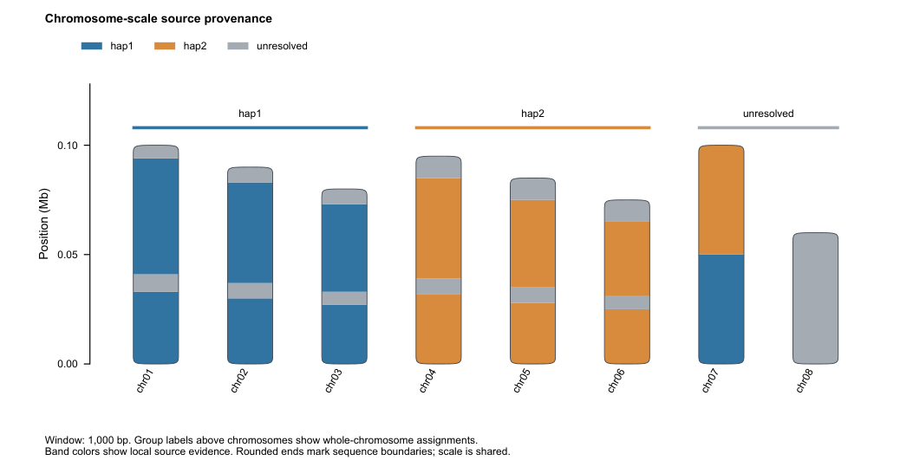

# HapReturn

**将合并调整后的 2n 组装，按原始 hifiasm hap1/hap2 来源回分为两套 n。**

软件将原始 hap1、hap2 contig 分别比对到最终组装，根据覆盖证据恢复两套来源。
无论二倍体、四倍体、八倍体或更高倍性，逻辑始终是 **2n → n + n**。
这里 n 是总染色体数的一半，例如 2n=64，目标就是两套各 32 条染色体。

## 安装与运行

需要 Python 3.9+；提供 FASTA 时需安装 minimap2，已有 PAF 可直接分析。

```bash
python -m pip install .
hapreturn \
  --final-fasta curated.fa \
  --hap1-fasta original.hap1.fa --hap2-fasta original.hap2.fa \
  --chromosome-list chromosomes.txt --threads 24 \
  --out-dir result
```

不同倍性使用同一条命令，无需指定倍性。`chromosomes.txt` 每行一个最终组装的
染色体 ID；也可用 `--chromosome-count N` 选择前 N 条记录，均不指定时分析全部。
未选入的记录保存在 `unplaced.fa`。

已有比对结果可改用 `--hap1-paf`、`--hap2-paf`；query 为原始来源 contig，
target 为最终组装。默认输出 `hap1.fa`、`hap2.fa` 两套来源。

## 示例

```bash
hapreturn \
  --final-fasta examples/octoploid/final.fa \
  --hap1-paf examples/octoploid/hap1.paf \
  --hap2-paf examples/octoploid/hap2.paf \
  --min-aln-len 1 --out-dir example_result
```

预期：16 条输入染色体回分为 hap1、hap2 各 8 条。1 bp 阈值仅用于此合成示例。

## 论文图与 HTML 报告

默认只导出三个独立 PDF 和一个完整 HTML 报告：

| 文件 | 内容 |
|---|---|
| `partition.pdf` | 两张图：来源覆盖证据及数量/长度统计；按长度比例绘制的染色体来源图 |
| `alignment_matrix.pdf` | 原始 contig × 调整后染色体的比对矩阵热图 |
| `hap_comparison.pdf` | 原始 hifiasm hap 与调整后 hap 的染色体来源对应图 |
| `report.html` | 汇总全部图形，提供窗口悬停与染色体表筛选 |

PDF 使用嵌入式可编辑字体、5–7 pt 无衬线文字和 183 mm 页宽，大规模数据
自动分页保持标签可读。蓝色、橙色始终表示两个原始来源，灰色表示待确认。
染色体按实际长度比例绘制圆端轮廓，不推测着丝粒位置。不会另存 PNG 或 SVG。



`--plot-window-size N` 设置窗口宽度（bp），默认按最长染色体约 100 个窗口
自动选择；`--no-plots` 关闭可视化。窗口表 `window_provenance.tsv` 保存去重
覆盖量，坐标从 0 开始、左闭右开；矩阵和连接证据另存为
`alignment_matrix.tsv`、`alignment_links.tsv`。所有倍性使用相同绘图逻辑。

### 独立绘制原始与调整后 hap 的对应关系

提供原始 contig 到最终组装的两个 PAF，以及已有的分配表：

```bash
hapreturn-chromosomes \
  --final-fasta curated.fa --hap1-paf hap1.paf --hap2-paf hap2.paf \
  --assignment result/assignment.tsv --out-pdf original_to_curated.pdf
```

安装后也可使用 `python scripts/plot_chromosomes.py`，参数相同。
左侧为有有效比对的原始 hifiasm contig，右侧为调整后染色体与 hap 标签；
连接带颜色表示原始来源，并保留比对区间与正反方向。两个侧面的长度比例一致。
自定义来源可加 `--source-labels FIRST SECOND`；过滤阈值应与分型时一致。

## 结果与参数

默认保留 mapQ ≥10、比对长度 ≥10 kb 的记录，合并重叠区间后计算两个来源的
覆盖量。优势来源覆盖染色体至少 25%，且占两来源覆盖量之和至少 60% 时接受标签。
阈值可通过参数调整。

输出包括 `hap1.fa`、`hap2.fa`、待确认的 `unresolved.fa`、未选入的 `unplaced.fa`、
逐染色体证据表 `assignment.tsv` 和汇总表 `summary.tsv`。保留染色体 ID，流式
写出序列。来源按比对证据判定，数量不通过强行分配来凑齐。

`--ploidy`、`--homolog-groups` 和组内来源数量参数仅用于可选检查，不改变拆分逻辑。
也可为两个来源自定义名称。退出码 0 表示成功，1 表示输入或比对错误，2 表示
有待确认结果；退出码 2 时仍保留输出。

完整参数见 [英文说明](README.md)，计算方法见 [方法说明](docs/method.md)。
采用 [MIT 许可证](LICENSE)。
